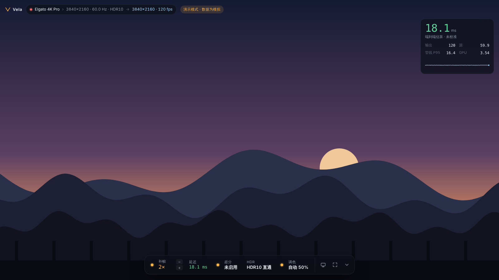

# Vela

为采集补帧定制的播放器：Elgato 4K Pro 采集 PS5 / Switch 2 的画面，在 RTX 5070 Ti 上用 DLSS 帧生成补帧后输出。只支持 Windows 11。

基于 [Veyra 2.1.0](https://github.com/Likely7/Veyra-NRVideo)（GPL-3.0）裁剪重写：去掉了 DLSS 5 / NR 适配、AMD 与 Intel 路径、文件播放、串流、导出等，只保留五项功能，按优先级：

1. **补帧**：DLSS 帧生成 2×–6×，内容帧率自动 / 30 / 60 / 120（跳过重复画面，倍数按游戏帧率算），NVIDIA 硬件光流提供运动矢量，按批锚定的帧节奏（均匀 / 低延迟）
2. **延迟监控**：分阶段 GPU 计时、管线 P50/P95、帧间隔曲线、补帧额外延迟、可校准的端到端估算，画面内角标
3. **超分辨率**：SDR 用 RTX Video 超分，HDR10 用 DLSS 超分，自动选择
4. **HDR**：HDR10 直通、SDR → RTX Video HDR、HDR → SDR 色调映射，跟随主机自动切换
5. **自动调色**：色阶、白平衡、鲜艳度，缓慢平滑，保留有意为之的色调



## 现状

| 部分 | 状态 |
|---|---|
| 界面 `ui/` | 完成；浏览器直接打开 `ui/index.html` 即为演示模式（模拟数据） |
| 跨平台核心 `core/` | 完成；45 个单元测试通过 |
| 管线模拟 `demo/vela_sim` | 完成；用真实节奏 / 统计代码跑 7 个主机场景（含 30 fps 内容） |
| Windows 源码 `win/` | 完成，未在 Windows 上编译运行；MinGW 类型检查 19/19 通过，6 个着色器 DXC 编译通过 |
| 真机验证 | 未做，见 [实施计划](docs/03-Windows实施计划.md) |

## 文档

- [01 功能裁剪](docs/01-功能裁剪.md)：从上游保留、移植、删除了什么
- [02 后端架构](docs/02-后端架构.md)：线程、GPU 管线六条路线、帧节奏、延迟模型、自动调色、性能取舍
- [03 Windows 实施计划](docs/03-Windows实施计划.md)：环境、构建、分阶段验收、风险、测试矩阵

## 快速试用（任何系统）

```bash
# 界面演示
open ui/index.html            # 或在浏览器里打开

# 核心测试与管线模拟
cmake -S . -B build -G Ninja && cmake --build build
./build/vela_core_tests
./build/vela_sim              # 各场景的延迟 / 帧间隔
./build/vela_sim --color      # 自动调色收敛过程
```

## Windows 构建

需要 DLSS SDK、Optical Flow SDK、RTX Video SDK 运行库，详见 [03 · 构建](docs/03-Windows实施计划.md#1-构建半天)。

```powershell
cmake -S . -B build -G Ninja -DCMAKE_BUILD_TYPE=Release -DVELA_DLSS_SDK=<DLSS> -DVELA_NVOF_SDK=<OpticalFlowSDK>
cmake --build build
```

快捷键：Home 显示 / 隐藏界面，F 开关补帧，2–6 切换倍数，L 开关延迟角标，M 静音，Alt+Enter 或双击切换全屏。全屏播放时界面完全隐藏、光标隐藏；用快捷键改设置时只在顶部闪一条提示。

## 许可

GPL-3.0（继承自 Veyra）。第三方代码与 SDK 见 [THIRD_PARTY_NOTICES.md](THIRD_PARTY_NOTICES.md)。NVIDIA 的 SDK 与运行库不在本仓库内，按各自许可获取。
