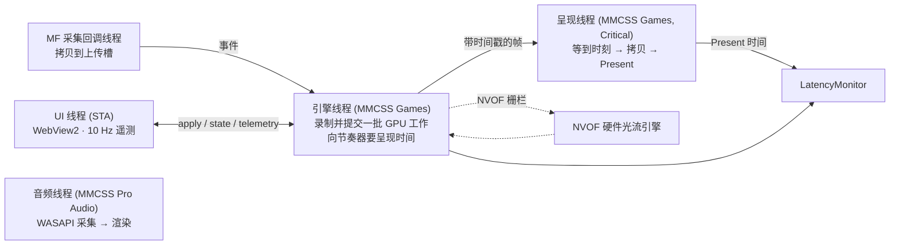

# 02 · 后端架构

目标机器：Windows 11、RTX 5070 Ti（Blackwell，16 GB，PCIe 5.0）、Elgato 4K Pro（PCIe，HDMI 2.1 输入，4K60 HDR10 / 1440p120 / 1080p240 采集）。信号源：PS5、Switch 2。

## 分层

```
ui/              HTML 界面（WebView2 承载；浏览器直接打开即为演示模式）
core/            与平台无关的逻辑：帧节奏、延迟统计、自动调色、管线规划、设置（Linux 上有单元测试）
win/src/app      窗口、WebView2 覆盖层、JSON 协议、设置文件
win/src/engine   引擎线程、GPU 管线、呈现线程
win/src/capture  Media Foundation 采集、Elgato 私有属性
win/src/nv       NGX 核心、DLSS-G、DLSS SR、RTX Video、NVOF、Reflex
win/src/gfx      D3D12 设备、计算通道、交换链、GPU 计时
win/src/audio    WASAPI 音频直通
win/shaders      6 个计算着色器
```

`core` 不依赖 Windows，决策逻辑都放在这里：用多少倍补帧、什么时候显示哪一帧、延迟怎么算、颜色怎么修。Windows 层只负责执行。这样最容易出错的部分可以在任何机器上测试，`demo/vela_sim` 也直接调用这份代码。

## 线程



- **采集回调线程**（Media Foundation 工作线程）：拿到 `IMFSample`，用 `IMF2DBuffer2::Lock2DSize` 直接读驱动缓冲，一次 `memcpy` 写进 D3D12 上传堆的空闲槽（常驻映射、写合并内存），记下 QPC 到达时间。4K NV12 约 12 MB、P010 约 25 MB，上游在同类机器上实测这一步 P50 约 1 ms。
- **引擎线程**：取最新的就绪槽（旧的丢弃并计数），录制一批 GPU 工作，然后让 `FramePacer` 给这一批的每一帧分配呈现时刻，交给呈现线程。GPU 从上传堆直接读原始字节，不做 CPU 端格式转换，也不做额外的 GPU 拷贝。
- **呈现线程**：按时刻等待（高精度可等待计时器睡到目标前 0.7 ms，然后自旋），尺寸一致且没有角标时用 `CopyResource` 把帧拷进后台缓冲，否则走 `Compose` 着色器缩放并叠加角标，然后 `Present`。只有它碰交换链。
- **UI 线程**：WebView2 要求 STA。只做转发：页面 → `engine.apply()`，引擎 → 页面（状态变化时推送，遥测 10 Hz，界面隐藏时不推送）。
- **音频线程**：见“音画同步”。

## GPU 管线

每个采集帧对应一批 GPU 工作。管线按计划构建一次（GPU 空闲时），只创建这个计划需要的中间纹理。每条路线的最后一步都直接写进真实帧纹理，不额外拷贝。

```
上传堆原始字节 ─ CaptureToWorking ─┬─ 工作纹理 RGBA16F（编码值：SDR 为 sRGB，HDR 为 PQ）
                                   └─ 光流输入 BGRA8（4K 降到 1920×1080）
工作纹理 ─ Analysis ─ 自动调色统计（每 4 像素采样，回读两帧后使用，CPU 不等待）
工作纹理 ─ ColorApply ─ 路线需要的格式 ─ [超分] ─ [RTX HDR + Encode] ─ 真实帧
NVOF(上一帧, 当前帧) ─ FlowToMotion ─ 输出分辨率运动矢量 ─ DLSS-G × (n−1) ─ 生成帧
```

光流在 NVOF 自己的引擎上执行，与调色、超分、HDR 并行。只有 DLSS 超分（需要运动矢量）或帧生成开始前，队列才等待光流的栅栏。

### 六条路线

| # | 信号 → 显示 | 超分 | 步骤 | 真实帧格式 |
|---|---|---|---|---|
| 1 | SDR → SDR，或 HDR → SDR 显示器 | 无 | ColorApply → 真实帧 | RGBA8 |
| 2 | 同上 | RTX Video | ColorApply → RGBA8 → VSR → 真实帧 | RGBA8 |
| 3 | SDR → HDR 显示器（RTX HDR） | 无 | ColorApply → RGBA8 → TrueHDR → scRGB → Encode → 真实帧 | RGB10A2 PQ |
| 4 | 同上 | RTX Video | ColorApply → RGBA8 → VSR → TrueHDR → Encode → 真实帧 | RGB10A2 PQ |
| 5 | HDR10 → HDR 显示器 | 无 | ColorApply（PQ→PQ）→ 真实帧 | RGB10A2 PQ |
| 6 | 同上 | DLSS | ColorApply → 线性 FP16 → DLSS SR → Encode → 真实帧 | RGB10A2 PQ |

超分引擎由画面决定，不给用户选：RTX Video 超分专为视频设计，但只接受 8 位 SDR；HDR10 画面只能用 DLSS 超分（线性 FP16 输入）。HDR 信号接到 SDR 显示器时，引擎改用 NV12 采集，让卡自己做色调映射（与 OBS 的做法一致）；强制 P010 时走 GPU 色调映射，结果是 SDR，所以仍用 RTX Video 超分。

RGB10A2 PQ 同时也是 DLSS-G 的 HDR 输入格式和 HDR10 交换链格式。HDR 路线从头到尾不经过 FP16 交换链，帧生成也不需要格式转换。

### 资源状态约定

- 完成的真实帧 / 生成帧停在 `NON_PIXEL_SHADER_RESOURCE | COPY_SOURCE` 组合只读状态。呈现线程直接拷贝或采样，不用自己做状态转换。
- RTX Video SR 的输入输出为 `COMMON`（SDK 约定）；TrueHDR、DLSS SR、DLSS-G 的输入为 `NON_PIXEL_SHADER_RESOURCE`，输出为 `UNORDERED_ACCESS`。
- NGX 调用会改动描述符堆和根状态，所以每个计算通道都重新绑定。
- 批次槽 3 个、上传槽 4 个。引擎重用某个批次槽之前，先等呈现线程释放它，再等它的拷贝栅栏完成。

## 内容帧率（`core/ContentCadence`）

游戏帧率常低于 HDMI 帧率：60 Hz 信号里的 30 fps 游戏，每个画面会连续发两次；120 Hz 里的 40 fps 模式会发三次。DLSS-G 必须在两张**不同**的画面之间插帧，所以重复画面要先找出来跳过，倍数也按内容帧率算（30 fps × 4 = 120 fps）。

- **检测**（`PictureCompare`）：采集线程在拷贝前比较原始 NV12 / P010 字节，取每 8 行、每 4 个样本（P010 只看高字节），4K 约 40 万次比较，约 0.3 ms。差异超过 2 级的样本多于 0.05% 才算新画面。主机发的重复帧是逐位相同的，这个阈值只用来吸收采集噪声。
- **跳过**：补帧开启时，重复画面在拷贝之前就丢掉，不进 GPU。30 fps 内容的采集拷贝和 GPU 工作也因此减半。
- **自动**：取最近 24 个“新画面间隔”的中位数，吸附到常见帧率（24 / 25 / 30 / 40 / 48 / 50 / 60 / 90 / 100 / 120，误差 6% 以内），新值稳定 1 秒才切换。超过 100 ms 的间隔算作暂停，不计入统计。
- **手动 30 / 60 / 120**：比上一张新画面早于 3/4 个内容间隔出现的变化，判定为以信号帧率刷新的 HUD 或叠加层，不当作新的游戏帧。这是“自动”误判时的兜底，例如游戏 30 fps、HUD 60 fps 的情况。
- **暂停后重置**：两张新画面之间超过 2.5 个内容间隔（菜单停住、加载画面）时，给 DLSS-G 和 DLSS SR 发 reset，避免在时间上不相关的两张画面之间插帧。
- **不重建管线**：生成帧纹理按驱动允许的最大倍数分配。内容帧率变化只会改变倍数上限，切换时管线不重建，只让 DLSS-G 重新开始历史。

30 fps 内容的代价是延迟：真实帧要等下一张新画面，4× 时管线 P50 约 35.6 ms（`vela_sim`），比 60 fps 内容多约 12 ms。“低延迟”节奏在这里收益最大。

## 帧节奏（`core/FramePacer`）

补帧只能在下一帧真实画面 B 到达之后，才能生成 A 与 B 之间的帧。所以真实帧一定要等：

```
G1 在 B 到达 + 预算 时显示，Gk 再往后 (k−1)·s，B 在 (n−1)·s 之后
预算 = 最近 120 批处理耗时的 P95 + 1 ms     s = T/n（均匀）或 T/n·(1−压缩量)（低延迟）
真实帧延迟 = 预算 + (n−1)·s
```

- 每一批都锚定在**自己的到达时间**上，不接在上一次 Present 后面，所以一批变慢不会让延迟越积越多。迟到超过半个间隔的生成帧直接丢弃，真实帧从不丢。
- 预算上升立即生效，下降每批最多降 1/8 个子帧间隔，避免一次偶然变快把相邻两批挤在一起。
- 源帧间隔取最近 32 个间隔的中位数，采集卡偶尔丢一帧也不影响。
- “低延迟”节奏把生成帧排得更紧，4× 时真实帧提前约 4.4 ms，代价是一个源周期内的帧间隔不均匀。

用 `demo/vela_sim` 跑的结果（真实节奏和统计代码，GPU 开销是按上游 RTX 5070 实测缩放出来的估算，采集卡延迟未计入）：

| 场景 | 补帧 | 管线 P50 | 补帧额外延迟 | 帧间隔 P99 |
|---|---|---|---|---|
| PS5 4K60 HDR → 4K 144 Hz | 2× 均匀 | 16.2 ms | 10.4 ms | 8.76 ms |
| PS5 4K60 HDR → 4K 240 Hz | 4× 均匀 | 23.0 ms | 17.0 ms | 4.57 ms |
| 同上 | 4× 低延迟 | 18.6 ms | 17.0 ms | 8.95 ms |
| PS5 1440p120 → 4K 240 Hz，超分 | 2× 均匀 | 11.8 ms | 6.3 ms | 4.59 ms |
| NS2 1080p60 → 4K 240 Hz，超分 + RTX HDR | 4× 均匀 | 23.4 ms | 17.0 ms | 4.57 ms |
| NS2 4K60 HDR，补帧关 | — | 3.4 ms | — | 17.32 ms |

## 延迟监控（`core/LatencyMonitor`）

能测到的，分开报告：

| 量 | 来源 |
|---|---|
| 采集拷贝 | 回调线程里 `memcpy` 的耗时 |
| 各 GPU 阶段 | D3D12 时间戳查询（上传转换、光流、调色、超分、HDR、帧生成），只在 GPU 时钟域内相减 |
| 管线延迟 | 采集回调 QPC → 真实帧 `Present` 返回 QPC，P50 / P95 / P99 |
| 帧间隔 | 任意两次 `Present` 之间，用来看节奏是否均匀 |
| 源 / 输出帧率、丢帧 | 采集丢帧、跳过的生成帧分开计数 |

软件测不到的部分不编数字：HDMI 进卡到驱动回调之间的延迟、显示器的处理延迟由用户校准后填写（方法见 [03](03-Windows实施计划.md)），未校准时界面明确显示“未校准”。端到端估算 = 采集卡 + 管线 P50 + 半个刷新周期（扫描平均值）+ 显示器。生成帧混合了两帧真实画面，它的“年龄”不算输入延迟，所以只统计真实帧。

画面内角标由 `Compose.hlsl` 用 3×5 点阵字直接画进视频（HDR 下白色约 203 nits），不需要覆盖窗口。

## 自动调色（`core/AutoColor`）

输入是 GPU 统计（64 级亮度直方图、中间调与高光的线性 RGB 均值、平均色度），输出 9 个参数（黑位、白位、中间调伽马、暗部抬升、高光回落、RGB 增益、饱和度），在 `ColorApply.hlsl` 里应用。

### 预设与微调

五项修正各有一个 0–1 的量（饱和度是 −1 到 1），预设就是这五个量的一组起点。选预设会覆盖这五个量，之后可以单独微调；界面对比预设表，显示“已微调 · 恢复预设”。总强度和适应速度不属于预设。

| 预设 | 针对 | 去灰 | 压高光 | 提亮暗部 | 饱和度 | 白平衡 |
|---|---|---|---|---|---|---|
| 自然 | 日常（默认） | 0.5 | 0.3 | 0.2 | +0.3 | 0.5 |
| 去灰 | 发灰：黑位抬高、白位不足 | 1.0 | 0.2 | 0 | +0.5 | 0.5 |
| 压高光 | 过曝：大片接近白 | 0.5 | 1.0 | 0 | 0 | 0.4 |
| 降饱和 | 过饱和 | 0.4 | 0.3 | 0.1 | −1.0 | 0.4 |
| 提亮暗部 | 偏暗：中间调低或暗部死黑 | 0.5 | 0 | 1.0 | +0.3 | 0.4 |
| 去偏色 | 偏色 | 0.4 | 0.2 | 0.1 | +0.2 | 1.0 |

量只决定“允许修多少”，修不修、修多少仍由画面决定：正常画面在任何预设下都几乎不动。

### 各项修正

- **去灰 · 色阶**（只对 SDR）：黑位抬高（0.5 分位 > 0.03）时下拉，最多 0.06；高光不足（99.5 分位 < 0.92）时拉伸，白位最低降到 0.88；中间调落在 0.25–0.60 之外才往区间边缘推，伽马限制在 0.88–1.12。量按比例向恒等插值。
- **压高光**（只对 SDR）：编码值 0.5 以上的回落曲线 `v − H·3.375·x²(1−x)`（x 为 0.5–1 内的位置），0.5 与 1 不动，最大回落 H/2，在 0.83 处。≥0.97 的像素占比（4%–15%）或 75 分位（0.80–0.92）决定画面有多“爆”，H = 0.16 × 量 × 程度。保留白位不变，近白区域的层次被拉开，画面不会整体发灰。
- **提亮暗部**（只对 SDR）：0.5 以下的抬升曲线 `v + L·3.375·x(1−x)²`，0 与 0.5 不动，最大抬升 L/2，在 0.17 处。中位数低（0.28 → 0.12）或 <0.03 的像素占比高（8%–25%）决定程度，L = 0.16 × 量 × 程度。两条曲线在系数 0.44 以内单调，实际最大 0.16。
- **饱和度**：正的量只补平淡画面（平均色度 < 0.18，最多 +15%）；负的量总会压低 5%，画面越艳压得越多（色度 0.35–0.60 时再压到 −20%）。
- **白平衡**：灰度世界（中间调）与白点（高光）按 6:4 混合。修正比例 0.8 × 量；偏色超过 0.12 + 0.10 × 量 起逐渐当作有意为之（夕阳、警报红光），到 0.30 + 0.15 × 量 完全不修；增益限制在 ±(4% + 8% × 量)，并归一化保持亮度不变。量越大，修得越多，也越倾向于把较强的偏色当作错误。
- **HDR**：PQ 是绝对亮度，色阶和两条曲线不做，只做白平衡与饱和度；亮度与对比度交给 HDR 页（TrueHDR / 色调映射参数）。
- **时间平滑**：一阶指数跟随，时间常数慢 2 s / 正常 0.8 s / 快 0.3 s。直方图 L1 距离 > 0.6 判为场景切换，之后 0.4 s 内用 0.12 s 快速收敛。单元测试覆盖了“噪声下不抖动”。
- **总强度**：所有修正最后按 0–1 向恒等插值。

### 画面诊断与推荐

`AutoColor::diagnose` 对源画面（调色之前的统计，所以修正生效后结论不变）给五种问题各打 0–1 分：

| 问题 | 分数 |
|---|---|
| 发灰 | 黑位抬高（0.5 分位 0.03–0.07），或动态范围窄（0.75 → 0.55）且不是暗场景 |
| 过曝 | 与“压高光”的程度相同 |
| 过饱和 | 平均色度 0.35–0.60 |
| 偏暗 | 与“提亮暗部”的程度相同 |
| 偏色 | 偏色量 0.04–0.12 渐入，0.35–0.50 渐出（太强的多半是夕阳之类的有意色调） |

分数做 2 s 指数平滑；“自然”固定 0.5 作为门槛。最高分超过当前推荐 0.1 才换推荐，避免来回跳。HDR 下只诊断过饱和与偏色。推荐结果在遥测 `t.diagnosis` 里，界面显示为“画面诊断：发灰 → 推荐「去灰」[应用]”，点应用即切到该预设，之后照常微调。

## HDR

- 信号是否 HDR 由 Elgato 私有属性里的 HDMI InfoFrame 判断（EOTF = PQ / HLG），而不是看像素格式。每 0.5 s 轮询一次，主机切换 HDR 时自动重建管线。
- 显示器是否 HDR 由输出的当前色彩空间判断（`DXGI_COLOR_SPACE_RGB_FULL_G2084_NONE_P2020`）。
- 交换链 HDR 元数据使用信号的 MaxCLL / MaxFALL / 母版峰值。
- Elgato 非 MK.2 卡的 P010 是有限范围亮度加全范围色度（Nitlink 实测），按全范围解码色度，否则会过饱和。

## 音画同步

补帧让画面晚 15–25 ms 上屏。音频线程把“环形缓冲 + 设备队列”的总量维持在实测管线延迟 P50（5–120 ms），每 0.25 s 跟随一次。采集卡和声卡时钟漂移时，超出目标 30 ms 就丢掉最旧的音频，低于目标 8 ms 就重新预填（只在延迟变化后出现一次很短的间隙）。只支持 PCM。

## 界面层

界面是 `ui/` 下的三个文件加 `ui/fonts/`（IBM Plex Mono、JetBrains Mono、Manrope，均为 OFL），由 WebView2 以 `https://vela.ui/` 虚拟主机加载，不走网络。

两种布局，同一套控件，随窗口状态自动切换：

- **窗口（方案 B · 监视器）**：顶部信号链（LIVE 指示、输入格式、内容帧率、输出）、左侧画面、下方帧间隔曲线、右侧仪表栏（端到端延迟与构成常驻，下面是各功能的标签页）。界面就是布局本身，不自动隐藏；Home 收起 / 展开仪表栏。画面区域是页面上的一个“洞”（用超大阴影把四周涂成底色），页面把它的位置（设备像素）发给宿主，呈现线程把视频按比例放进这个区域，延迟角标也画在区域内。
- **全屏（方案 D · 侧轨）**：画面铺满。左侧窄栏放五项功能的状态（倍数、延迟、超分、HDR、调色）以及静音、设备、退出全屏；点一项在旁边展开它的面板，再点一次收起。4 秒无操作后侧轨淡出，覆盖窗口随之整个隐藏，只剩显卡画进视频的延迟角标。

- 覆盖窗口：属于视频窗口的无边框弹出窗口，`WS_EX_NOREDIRECTIONBITMAP`。WebView2 用可视化承载（CompositionController + DirectComposition），页面背景透明，所以控制栏和面板浮在视频上。
- **界面隐藏时覆盖窗口整个隐藏。** 此时全屏视频窗口是屏幕上唯一的内容，Windows 11 会把它提升为独立翻转，`Present` 不经过 DWM 合成。界面显示时会多一次合成，只在调设置时发生。
- 鼠标在视频上移动或按 Home 显示界面；4 秒无操作自动隐藏。
- 同一套页面在浏览器里打开时自动用内置的模拟引擎，方便不接硬件就评审界面。

不用 Qt 的原因：只剩五项功能，界面很小；HTML 可以在云端直接截图验证，演示版和正式版是同一份代码；WebView2 在 Windows 11 上自带，不需要打包 Qt 运行库。

## 针对 RTX 5070 Ti 的性能取舍

| 做法 | 原因 |
|---|---|
| 4K 光流降到 1920×1080，网格 4 | NVOF 开销约降到 1/4，运动矢量用双线性插值放大到输出分辨率；上游实测 1080p 光流约 1 ms |
| GPU 直接从上传堆读原始 NV12/P010 | 省掉一次 CPU 端格式转换和一次 GPU 拷贝 |
| 一条高优先级直接队列 | 引擎和呈现在同一队列上天然有序，不用跨队列栅栏；高优先级避免被浏览器等程序的 GPU 工作插队 |
| 交换链 `MaxFrameLatency = 1`、可等待对象、允许撕裂 | 呈现线程不会在 Present 里阻塞；VRR 下由节奏器决定时刻 |
| 帧尺寸与窗口一致时直接 `CopyResource` | 全屏时呈现每帧只有一次拷贝 |
| DLSS-G 性能模式（可选） | 上游实测 4× 批次时间减半，需要支持该参数的运行库 |
| 进程高优先级、关闭电源节流、线程加入 MMCSS | 减少调度抖动 |
| 自动调色统计异步回读 | CPU 从不等待 GPU；调色参数晚两帧，对缓慢变化的修正没有影响 |
| 不用 Reflex Sleep | 画面到达时间由主机决定，Sleep 只会增加延迟；保留低延迟模式与标记 |

## 出错时

- 所有进入 NVIDIA 运行库的调用都包在 SEH 里。一个功能崩溃或返回失败时，管线标记降级，引擎去掉该功能重新规划并重建，界面上会出现原因说明，视频不中断。
- 构建失败按“帧生成 → 超分 → RTX HDR”的顺序逐项关闭后重试。
- 没有采集卡时每 2 秒重新枚举一次。

## 设置与协议

设置保存在 `%LOCALAPPDATA%\Vela\settings.json`，日志在 `%LOCALAPPDATA%\Vela\logs\vela.log`。页面与宿主之间的 JSON 消息：

| 方向 | 消息 |
|---|---|
| 页面 → 宿主 | `{type:"hello"}`，`{type:"set", path:"frameGen.multiplier", value:3}`，`{type:"command", name:"toggleFullscreen" \| "resetStats" \| "hideUi"}`，`{type:"ui", visible:false}`，`{type:"viewport", x, y, w, h}` |
| 宿主 → 页面 | `{type:"state", settings, caps, plan, source, display, devices, modes, system}`，`{type:"telemetry", t:{…}}`，`{type:"ui", visible:true}`，`{type:"mode", fullscreen}`，`{type:"flash", text}` |

字段表在 `win/src/app/Protocol.cpp`，与 `ui/app.js` 里模拟引擎产出的结构一致。几个约定：

- `set color.preset` 会同时改写五个微调量；`settings.json` 里 `preset` 排在微调量前面，所以加载时先套预设，再叠加用户的微调。
- `caps.colorPresets` 是预设表（来自 `core::colorPresetAmounts`），页面用它判断“已微调”，不另存一份。
- 遥测 `t.color` 是当前生效的 9 个参数，`t.diagnosis` 是 `{scores:{natural, washed, overexposed, oversaturated, dark, cast}, recommended}`。
